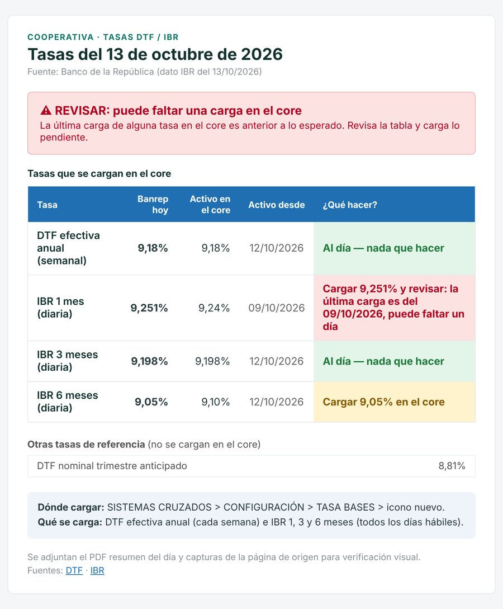
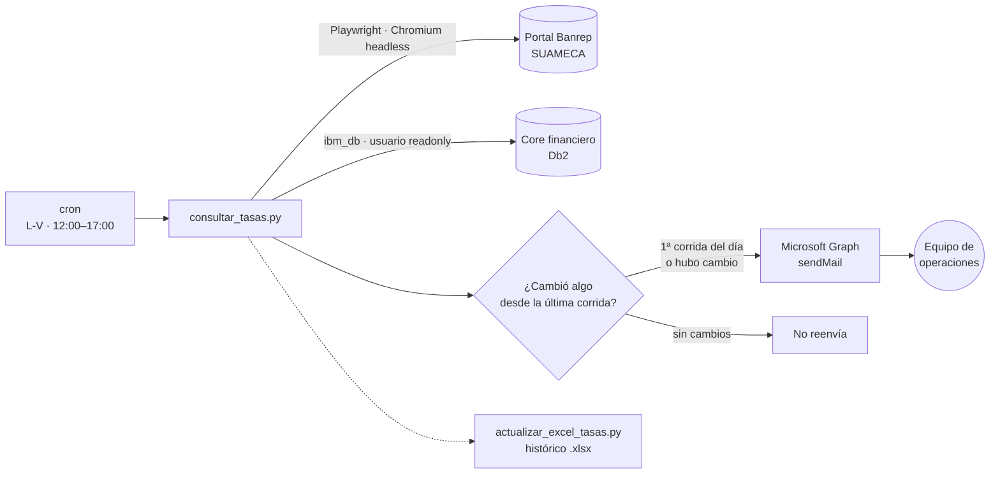

<div align="center">

# 💱 Alertas de tasas Banrep

**Automatización en servidor Linux que vigila las tasas DTF e IBR del Banco de la República, las compara con el core financiero y avisa por correo qué hay que actualizar.**

[](https://github.com/juandbueno9/alertas-tasas-banrep/actions/workflows/ci.yml)


</div>

---

## 🎯 Problema

En una entidad financiera las tasas de referencia (**DTF** semanal e **IBR** diaria) se cargan a mano en el core todos los días hábiles. Si alguien olvida una carga, los créditos indexados se liquidan con una tasa vieja, y eso solo se descubre cuando ya hay diferencias contables.

## ✅ Solución

Un proceso automático que corre cada hora en horario laboral y:

1. **Consulta** las tasas en el portal del Banco de la República (SUAMECA) con un navegador headless.
2. **Lee** las tasas cargadas en el core con un usuario de **solo lectura**.
3. **Compara** valor y fecha de vigencia contra el día hábil esperado.
4. **Envía un correo** con semáforo por tasa: *al día*, *pendiente* o *revisar*, con PDF resumen y capturas del portal como evidencia.
5. **Opcional:** actualiza el Excel histórico de tasas sin sobrescribir datos existentes.

<div align="center">

<br/><sub>Correo generado por el script (datos de ejemplo)</sub>
</div>

---

## 🏗️ Arquitectura



### Lógica de alertas

| Estado | Condición | Acción sugerida en el correo |
|---|---|---|
| 🟢 **Al día** | El valor del core coincide con el de Banrep (tolerancia 0,0005) | Nada que hacer |
| 🟡 **Pendiente** | El valor es distinto | "Cargar X% en el core" |
| 🔴 **Revisar** | La última carga es anterior al día hábil esperado | "Cargar X% y revisar: puede faltar un día" |
| ⚪ **Sin dato** | No se pudo consultar el core | "Cargar X% (no se pudo verificar)" |

**Detalles que evitan correos de más:**
- La **primera corrida del día** siempre envía el correo; las demás solo si Banrep publicó un cambio. Para eso se compara un *snapshot* del último estado.
- El **día hábil esperado** se calcula saltando fines de semana.
- Si el portal de Banrep falla, se envía un **correo de error** con el detalle técnico, sin quedarse callado.

---

## 🧰 Stack

| Componente | Uso |
|---|---|
| **Python 3** | Lógica principal |
| **Playwright + Chromium** | El portal de Banrep es dinámico y bloquea clientes no-navegador |
| **ibm_db** | Consulta de solo lectura a la base del core (Db2 LUW) |
| **Microsoft Graph + OAuth2** | Envío de correo con *client credentials* (sin contraseñas SMTP) |
| **ReportLab** | PDF resumen adjunto |
| **openpyxl** | Actualización del Excel histórico |
| **cron + bash** | Programación e instalación en Ubuntu Server |

---

## 🚀 Instalación en servidor (Ubuntu)

```bash
git clone https://github.com/juandbueno9/alertas-tasas-banrep.git
cd alertas-tasas-banrep
cp config_ejemplo.py config.py     # completa credenciales (config.py está en .gitignore)
bash instalar.sh
```

`instalar.sh` es **idempotente** (se puede correr varias veces sin efectos duplicados) y:

1. Valida que existan los archivos necesarios antes de tocar nada (`set -euo pipefail`).
2. Instala Python, crea el `venv` e instala dependencias.
3. Instala Chromium para Playwright **con sus librerías del sistema** (`install-deps`).
4. Hace una **prueba en seco** (consulta sin enviar correo).
5. Programa el `cron`, ajustando la hora si el servidor no está en hora de Colombia (UTC-5).

Guía paso a paso: [despliegue_servidor_linux.md](despliegue_servidor_linux.md)

### Uso manual

```bash
python consultar_tasas.py            # consulta, compara y envía el correo
python consultar_tasas.py --solo-ver # solo muestra en pantalla, sin enviar nada
```

---

## ⚙️ Configuración (`config.py`)

| Variable | Descripción |
|---|---|
| `AZURE_TENANT_ID` / `AZURE_CLIENT_ID` / `AZURE_CLIENT_SECRET` | App de Entra ID con permiso de aplicación `Mail.Send` |
| `AZURE_REMITENTE` | Buzón que envía |
| `DESTINATARIOS` | Lista de correos |
| `URL_DTF` / `URL_IBR` | Páginas fuente del Banrep |
| `DB2_HOST` / `DB2_PORT` / `DB2_DATABASE` / `DB2_USER` / `DB2_PASSWORD` | Conexión de **solo lectura** al core |
| `EXCEL_RUTA` | Ruta del Excel histórico (vacío = no se toca) |

---

## 🔐 Seguridad

- `config.py` **nunca** se sube a git (ver `.gitignore`). Solo se versiona `config_ejemplo.py`.
- Usuario de base de datos **readonly**. El script nunca escribe en el core.
- Correo por Microsoft Graph con permiso mínimo (`Mail.Send` de aplicación) en lugar de SMTP con contraseña.
- Secreto de la app rotado al pasar a producción.

## 📁 Estructura

```text
alertas-tasas-banrep/
├── consultar_tasas.py          # Consulta Banrep + core, compara, PDF y correo
├── actualizar_excel_tasas.py   # Llena el Excel histórico sin sobrescribir datos
├── config_ejemplo.py           # Plantilla de configuración
├── instalar.sh                 # Instalador idempotente para Ubuntu + cron
├── despliegue_servidor_linux.md
├── instrucciones.md            # Programación en macOS (launchd) y operación
└── docs/correo-ejemplo.jpg
```

## 🗺️ Mejoras futuras
- [ ] Empaquetar como contenedor Docker
- [ ] Métricas para Prometheus (última ejecución, tasas pendientes)
- [ ] Pruebas unitarias de `_estado_fila` y `dia_habil_anterior` (con festivos de Colombia)

---

**Autor:** [Juan Bueno](https://github.com/juandbueno9) · Licencia [MIT](LICENSE)
